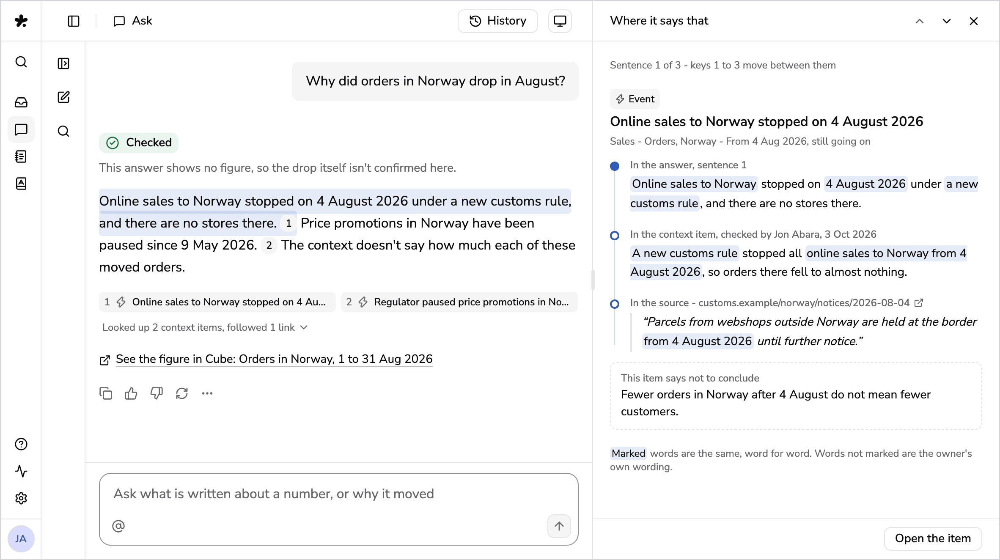

<div align="center">

<picture>
  <source media="(prefers-color-scheme: dark)" srcset="docs/images/footnote-lockup-dark.svg">
  
</picture>

[Docs][docs] &nbsp;·&nbsp; [The proof](#the-proof) &nbsp;·&nbsp; [Try it](#try-it) &nbsp;·&nbsp; [What is true today](#what-is-true-today) &nbsp;·&nbsp; [Contributing](#contributing)

</div>

Footnote is where the people who know why a number moved write it down, and the owner of that part
of the business checks it. When someone asks an AI agent about the number, the answer comes with a
footnote that says who checked it and when.

<p align="center">
  
</p>

## The proof

<!-- PROOF RESULT, a placeholder. After the first funded run of the invented company's proof
     (`npm run held-out -- prove --real --cap 25`), the owner replaces everything between this
     comment and the closing one with that run's table, as the command printed it, whatever it
     shows: the model and the judge, the questions' digest, and what it spent. -->

**Not run yet.** The same 40 questions about a period and a value will be asked three ways
through a real agent: with no context, with the same facts as one plain file, and with Footnote.
The table goes here after the first funded run, whatever it shows. [Run the proof][prove] says
what the command asks, how to read the table, and how to run it on your own context.

<!-- END OF PROOF RESULT -->

## Why

An AI agent can read your sales table. It can't know that a customs rule stopped online sales to
Norway on 4 August, because that lives in someone's head or a chat thread. So when orders there
fall, it guesses, and the guess sounds as sure as a fact.

In Footnote the person who knows writes it down once, in a couple of sentences with a source. The
owner of Sales checks it and publishes it. Agents connected to Footnote read it before they answer,
and say where it came from. When nothing is written down, the answer says so instead of filling the
gap.

Footnote keeps what the numbers mean, not the numbers. Your semantic layer, such as Cube or dbt,
still defines the figures and returns them.

## Try it

You need Docker. The first start builds Footnote and loads the demo, which can take ten minutes.

1. Get the code and start it:

   ```sh
   git clone https://github.com/Fredehagelund92/footnote.git && cd footnote
   docker compose up
   ```

2. Open <http://localhost:8080>. You are Ravi Kapoor, the admin of an invented outdoor-gear retailer.
3. Open **Ask** and ask _How did orders in Norway change in October 2026?_ The answer is marked
   Checked and puts the customs rule first.

It runs on your computer with invented data and calls no AI service. `docker compose up` builds
the images from the code you cloned, so you get what this page describes. Ctrl+C stops it.

[Try the demo][try-the-demo] has the rest, such as connecting Claude Code to the demo, and
[Use your own data][own-data] runs it on your own semantic layer.

## What is true today

Footnote has not had its first release yet. It is for trying on one computer, not for production
use, and it will change before 1.0.

- The whole loop works on the demo. Someone writes a context item, its owner reviews it and
  publishes it, agents read it over MCP, and a question nothing answers goes back to the owner.
- Agents read only what an owner published. Drafts, suggestions and comments never reach them.
- Footnote reads metric definitions from Cube and dbt MetricFlow. It turns documents in Git and
  Google Drive into suggestions for an owner to review.
- Agents on your computer, such as Claude Code, connect over MCP and sign in as a person. An agent
  in the cloud needs Footnote at an address on the internet.
- In the demo, Ask answers on scripted models. Started with a model key, it answers on a real
  model, which costs money and sends the context it reads to that provider.
- There is no measured figure yet for how much better an agent answers with Footnote.
- Nobody has run it on a named cloud host yet.
- The demo's sign-in lets anyone be the admin, so keep it off the internet.

## Docs

The [Footnote docs][docs] cover everything technical:

- [Try the demo][try-the-demo]: the quick start, from a clone to a checked answer and Claude Code.
- [Set up your workspace][set-up]: from an empty Footnote to a first checked answer.
- [Connect an agent][connect-an-agent]: Claude Code and other agents, over MCP. The
  [Agent tools][reference] has the tools.
- [Connectors][connectors]: where Footnote reads your definitions and documents.
- [Choose a model provider][model-providers]: the model behind Ask and the answer tests.
- [Back up, restore and upgrade][backups]: keep what people wrote, and [where to run it][where-to-run].
- [Service settings][configuration]: every setting the service reads.

## Contributing

The most useful change you can send is a connector. [Build a connector][connector-authoring] is
written so a coding agent can follow it from top to bottom. For anything else,
[CONTRIBUTING.md](CONTRIBUTING.md) has the commands. Open an issue first if the change is bigger
than a small fix, and please follow the [code of conduct](CODE_OF_CONDUCT.md).

Report a security problem privately, as [SECURITY.md](SECURITY.md) says, not in a public issue.

Footnote is under the [Apache License 2.0](LICENSE). You keep the copyright in your contributions.

<!-- The docs' address is DOCS_URL in src/domain/brand.ts; tests/lint/readme.test.ts holds these to it. -->

[docs]: https://getfootnote.vercel.app/docs/
[try-the-demo]: https://getfootnote.vercel.app/docs/try-the-demo/
[set-up]: https://getfootnote.vercel.app/docs/set-up-your-workspace/
[connect-an-agent]: https://getfootnote.vercel.app/docs/connect-an-agent/
[reference]: https://getfootnote.vercel.app/docs/tools/
[connectors]: https://getfootnote.vercel.app/docs/connectors/
[connector-authoring]: https://getfootnote.vercel.app/docs/connectors/authoring/
[model-providers]: https://getfootnote.vercel.app/docs/model-providers/
[own-data]: https://getfootnote.vercel.app/docs/use-your-own-data/
[backups]: https://getfootnote.vercel.app/docs/back-up-restore-and-upgrade/
[where-to-run]: https://getfootnote.vercel.app/docs/where-to-run/
[configuration]: https://getfootnote.vercel.app/docs/configuration/
[prove]: https://getfootnote.vercel.app/docs/prove/
