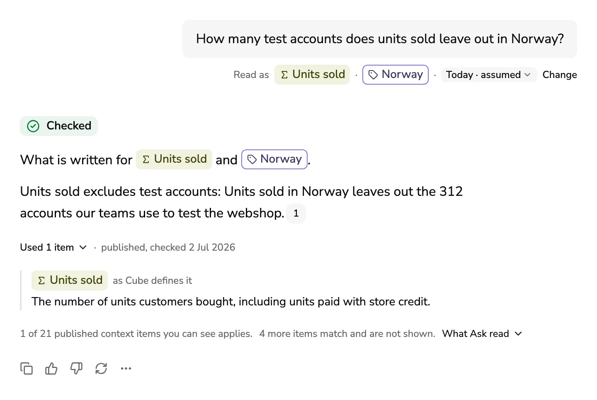

Ask answers a question about a number from the context your owners wrote and checked, and every answer starts with a line that says how much of it is written down. It reads published context with the same engine your agents use, and never more than you may see.

## Ask

1. Open **Ask**.
2. Type your question in the box, the way you would ask a colleague: "Why did orders in Norway drop in August?". Enter sends it, and Shift and Enter start a new line.
3. To point the question at something, type @ and pick a domain, a definition, a context item or a market.

Before your first question, the page can show what agents asked about this week, as counts only, never the words, with the answer each would get now.

With no AI model connected, Ask still answers: it lists what your team wrote and an owner checked.

## Read the answer

The answer starts with its [answer line](answer-lines.md): Checked, Partial, Not found, Conflict, Outdated or Not looked up. Press it to see what the line means and what you do next.

- **Read as**, under your question, shows what Ask read it as: the metric, the market and the dates. When the question named no dates, they read Today · assumed. **Change** puts the question back in the box, to change before you ask again.
- A number after a sentence is the context item it comes from. Point at it to see who checked it and when, and open it from there.
- Under the answer, its sources show by title, the first three and a count for the rest. Point at one to see which sentences it backs, and press it to open it. An item that is archived, may be out of date or is due for a check shows on its own line under them, so you never miss it.
- When you ask what something is, the answer is its definition card: the words of the tool that defines it, who owns it, and the context items about it, which open in the card. In other answers a definition shows as a quote, with the tool that defines it.
- When Ask stops at its time or step limit, the answer says Stopped and shows what is written, as agents get it. Ask again tries once more. When Ask read a metric or a market in your question, Search for these words opens Search on them.

### Figures

When an admin has switched figures on for a metric's tool, an answer that names dates can show the number too, with the tool it comes from and the day its data is from. Show the query has what was asked of the tool. Nothing the tool returned is kept: run the query in the tool to check it.

## Ask again at other dates

Press the dates in Read as. Choose Today, Any date, Last month, Last quarter or Last year, or Pick dates for days of your own. Ask asks the same question again at those dates, as a new answer under the last one.

## Ask a follow-up

Ask the next question in the same chat, such as "And in Spain?". Ask carries what your last question was about, and Read with shows what it carried. Drop them puts the question back in the box with what was carried in it, so you can take out what you do not mean. A question you point at something with @ does not carry anything.

**New chat** starts again with nothing carried.

## Ask how it works

Ask also answers questions about how it works, such as "What does Checked mean on an answer?" or "How do I add a context item?". It answers from these help pages and links the part of the page it used under the answer, such as Write context for "How do I add a context item?".

Such an answer has no answer line, since it rests on the help and not on your context.

When the answer says how to do something, a button under it opens that screen, such as Write context or Invite people. If the screen is not yours to use, the answer says who does it, and has no button.

## When nothing is written

A Not found answer means nothing is written about it yet, and a card under it says what is missing. If you do not own that domain, Tell the owner sends the owners what you asked about and the dates, never your words. It waits in their Inbox, where they can write it: [When nothing is written yet](when-nothing-is-written-yet.md).

When Ask finds no metric or context item that uses a word at all, Tell an admin sends the admins that word alone, never your question.

## When an answer is wrong

Under each answer, Good answer and Bad answer say how it went. When the answer cites a context item, Bad answer also opens a form: which part is wrong, what is wrong, and the correct version if you know it. Send it, and the owner sees it in their Inbox as a report: [Keep context up to date](keep-context-up-to-date.md).

## Save a question

The owners of a domain and admins can save a question, so it is answered again after every change. Press More under the answer, then Save question. Quality, in Observability, shows when a saved question's answer changes: [See what agents asked](see-what-agents-asked.md).

## Your chats

**History** lists your chats, newest first, with a search. Each new chat is a row of its own, even when it asks a question you asked before. Only you see them. They are kept in this browser and go when you sign out: [Privacy](privacy.md).
