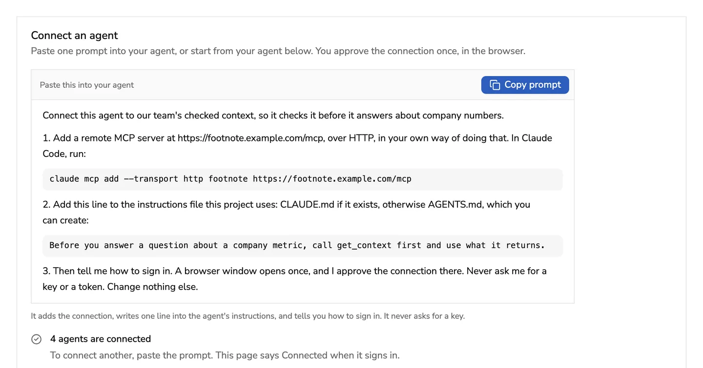
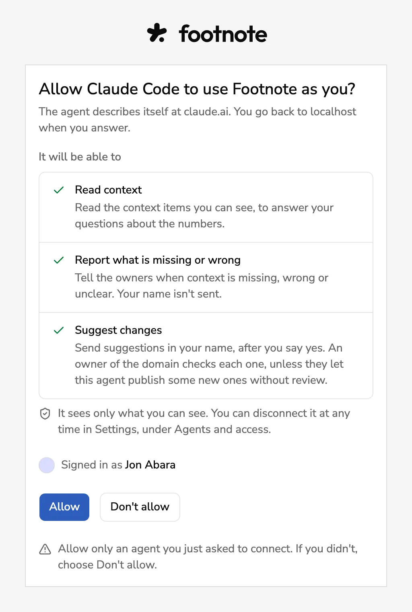

Connect Claude, Cursor or another agent, so it reads your published context before it answers a question about the numbers.

## Before you start

You need to be signed in. Anyone in the workspace can connect their own agent. In Agents and access, an admin sees every agent, and anyone else sees their own. An agent reads only context an owner has published, never comments, and a draft only for the person it writes with: [How agents use it](how-agents-use-it.md).

A job that runs on its own, with nobody there to approve a sign-in, does not use this prompt. It uses an access key, which an admin makes in Agents and access, under Tools and access keys.

## Paste the prompt



1. Open **Settings**, then **Agents and access**.
2. Press **Copy prompt** and paste it into your agent.
3. Let the agent run it. It adds the connection, writes one line into the project's instructions file (CLAUDE.md if there is one, otherwise AGENTS.md), and tells you how to sign in. It never asks for a key.

<!-- include prompt -->

```text title="The prompt, exactly as the app shows it"
Connect this agent to our team's checked context, so it checks it before it answers about company numbers.

1. Add a remote MCP server at https://footnote.example.com/mcp, over HTTP, in your own way of doing that. In Claude Code, run:

claude mcp add --transport http footnote https://footnote.example.com/mcp

2. Add this line to the instructions file this project uses: CLAUDE.md if it exists, otherwise AGENTS.md, which you can create:

Before you answer a question about a company metric, call get_context first and use what it returns.

3. Then tell me how to sign in. A browser window opens once, and I approve the connection there. Never ask me for a key or a token. Change nothing else.
```

<!-- /include -->

## Approve it once



Your browser opens a screen that names the agent and what it can do: read published context, and send a report or a suggestion after you say yes. Choose Allow. The page says Connected, with the agent's name and yours, and it joins Connected agents.

The agent stays connected for 30 days, or until it goes 7 days unused. Then it asks you to approve it again.

> **Cursor and VS Code.** They have one-click install links on the same page. Claude's app and ChatGPT take the address as a connector; their steps are under Prefer to do it by hand. Codex signs in with its one command, which opens the browser; `codex mcp login` is only for when it did not.

> **Claude's app.** It has no instructions file. Its steps give the line to paste into a Project's instructions instead.

## If nothing signs in

The page looks every few seconds. After two minutes it shows what usually helps, and after ten it stops, with Keep waiting:

<!-- include checks -->

- Paste the prompt into your agent and press Enter.
- Say yes when the agent asks to run the command.
- Approve the connection in the browser, or ask your agent how to sign in.
- If it says the server already exists, ask it to remove the old one and try again.

<!-- /include -->

## The tools each agent may call

Connected agents lists every agent by its name, with who it works for and how many of its tools are on.

Open Details on a row to see each tool the agent can call, such as:

- get_context, to read the context for a question
- find_context, to look a name up or see what is defined and written down
- read_context, to read one context item or one definition in full, with its links
- report, to say what is missing or wrong
- write_draft and read_draft, to write a draft with you and read it back as you left it, never sending it: [Write with your agent](write-with-your-agent.md)
- send_draft, to send your draft, after you say yes, to an owner who checks it before anything changes

An agent publishes only where an owner lets it [publish without review](publish-without-review.md), and Details shows where, with Turn off. Details also lists the suggestions it sent lately.

Admins switch each tool on or off for each agent in Details. A switch acts at the agent's next request, and it never lets an agent do more than the person allowed when they connected it: a tool they didn't allow can't be switched on. An agent with every tool off gets nothing. Every change is in the history log, with who made it.

A suggestion an agent sends names it in the Inbox and the review, as "Claude Code, with Kofi's OK".

> **Disconnecting.** **Disconnect** your own agent from Connected agents; an admin can disconnect any, and the history log keeps it. It signs out at once, and it can be connected again. Removing a person from the workspace disconnects their agents in the same step.
