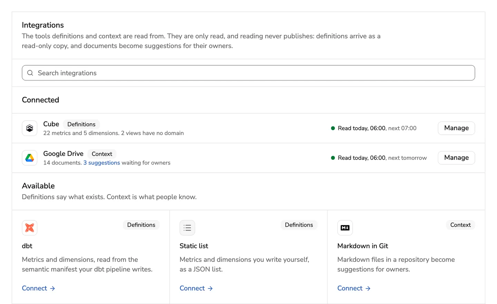

Connect the sources where metrics are defined and where documents live, and what is read from each.

## Definitions

Metric and dimension names arrive from the tool where they are defined, and stay read-only. dbt calls a group of metrics a semantic model, and its domain is read from `config.meta.domain`.

A tool can be read from its files in a repository, or through its own API with a key limited to one deployment. Some APIs give no calculations. Then a changed calculation flags nothing until the definition's type, title or description changes too, and the tool's page says so before you connect it.

A read makes a name for each new one, and an owner publishes them on one card in the Inbox, as [Set up your workspace](set-up-your-workspace.md#publish-the-names) shows. Until then, [Definitions](definitions-and-synonyms.md) doesn't list them. When a definition changes there, the context that relies on it comes back to its owners to check.

## Documents

A folder shared with a service account, or Markdown in a repository. A read never publishes: each document becomes a suggestion in its owners' Inbox.

## Connect a source

Only admins connect a tool. Open **Settings**, then **Integrations**, and choose **Connect** on a tool under Available. It takes five steps on one page:

1. Pick: the tool.
2. Connect: its settings, then **Test connection**.
3. Choose: the views, semantic models or folders to read.
4. Map: each to a domain. A folder's documents go to its domain's owners; a view or semantic model left without a domain stays shared.
5. Schedule: how often it is read and what each read does. Then say why it is added.

**Change settings** goes through the same steps, filled in. A token or a key left empty stays as it is. **Disconnect** stops reading the tool and forgets its key: its open suggestions are withdrawn, and what owners published stays.

## Choose what it reads

Your organisation decides which views or semantic models are its catalogue. **Choose views** under What it reads opens Choose, Map and Schedule, for every definitions tool. That includes one the person who hosts this app set up, whose settings stay theirs.

Every view is read until an admin chooses. A view taken out leaves Definitions at the next read, and the context that relies on it comes back to its owners to check. It keeps its domain, so choosing it again restores it.

A view the tool adds later is not read until it is chosen. The admins get one card in the Inbox, New views not chosen, which opens Choose.

## Figures in Ask

Off by default. Switched on per integration, Ask shows one figure, read when asked and kept nowhere, with its source, how fresh it is, and the data contact who hears about a figure that looks wrong.

Figures are not an integration of their own. Where your definitions source can read them, its page has a second connection for them, beside the one its definitions are read through, with its own data endpoint and its own read-only token.

The endpoint is the address of its data API, such as one ending in `/v1/load`: no MCP server and no warehouse login are needed.

An admin sets it up in the integration's figures connection. The token is sent only to the endpoint's address and never shown again.

- **Replace token** gives it a new token, and a new address needs its token again.
- **Try a figure** reads one measure for the last 7 days with the settings as saved, and says what came back or why nothing did. Nothing is kept, and figures stay as they are.

Then name the **Data contact** and switch on **Show figures in Ask**.

The metric's definition decides which integration answers. When someone says in Ask that a figure doesn't fit a context item, the figure and the item show side by side until the owner or the data contact has a look. Nothing picks one of them.
