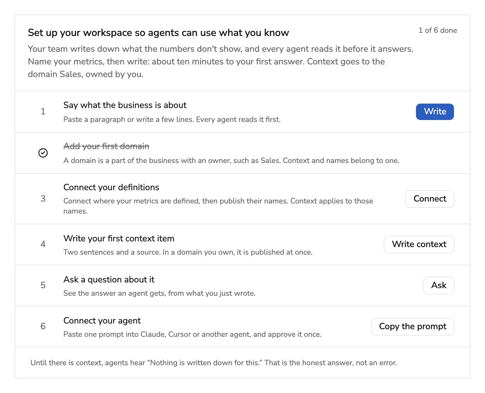

Here you write down what your numbers mean, so AI tools stop guessing. Your Inbox shows the six steps until you have done them, under Set up your workspace so agents can use what you know.

## The six steps

<!-- include setup-steps -->

1. **Say what the business is about**. Paste a paragraph or write a few lines. Every agent reads it first.
2. **Add your first domain**. A domain is a part of the business with an owner, such as Sales. Context and names belong to one.
3. **Connect your definitions**. Connect where your metrics are defined, then publish their names. Context applies to those names.
4. **Write your first context item**. Two sentences and a source. In a domain you own, it is published at once.
5. **Ask a question about it**. See the answer an agent gets, from what you just wrote.
6. **Connect your agent**. Paste one prompt into Claude, Cursor or another agent, and approve it once.

<!-- /include -->

## The page for each step

1. Say what the business is about: [About our business](write-context.md#about-our-business).
2. Add your first domain: [Domains and owners](domains-and-owners.md#add-a-domain).
3. Connect your definitions: [Integrations](integrations.md#connect-a-source), then [publish the names](#publish-the-names).
4. Write your first context item: [Write context](write-context.md).
5. Ask a question about it: [Answer lines](answer-lines.md).
6. Connect your agent: [Connect an agent](connect-an-agent.md).

## Publish the names

Each time your definitions are read, a name is made for every metric and dimension that has none yet. They wait on one card in the Inbox, and nothing is published until you publish it.

- **Publish all** makes the ready names live at once, so context can apply to them and agents can use them.
- **Look at these first** holds a name that would give a word a second meaning, such as two metrics both called Revenue. Keep it, change it, or leave it out. Nothing is picked for you.
- A family is one name for many near-identical metrics, such as a metric for each currency. Publish it, and its variants are published with it. Metrics whose names alone look alike wait under Look alike, to publish as one family or apart. See [Variants](metric-variants.md#if-you-keep-a-metric-for-each-variant).
- **Publish these as suggested** publishes, at one press, the names there only because another definition has the same name, each with the name shown, which tells it apart. A project that keeps one dimension, such as Region, in many semantic models has a copy for each.
- **Left out** holds dates and ids, which a context item's dates and Applies to already cover, and what you left out. While the card is open you can still publish any of them. Dates and ids alone never raise the card.

## Your first answer

Ask about what you wrote. The setup's "Ask a question about it" step writes the question for you, and it includes the item's dates when they do not cover today, so a question about a day that has passed still finds your item.

The answer starts with an answer line, such as Checked, and cites your context item. If it says Not found, nothing applies to that question yet: that is the honest answer, not an error.

> **Why names come first.** A context item must say what it applies to, and it can only name what is in Definitions. That is why the names come before you write.
