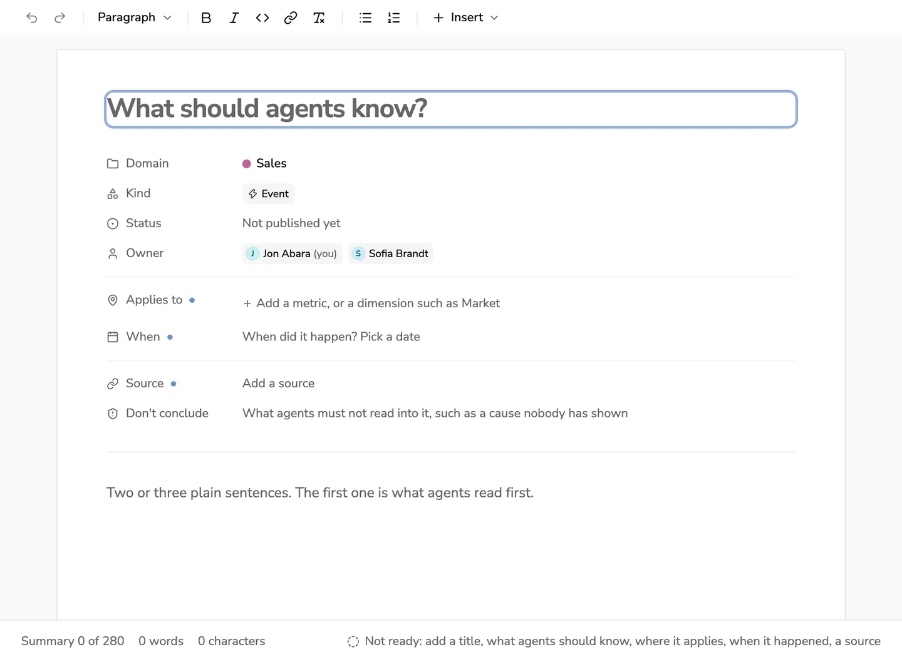
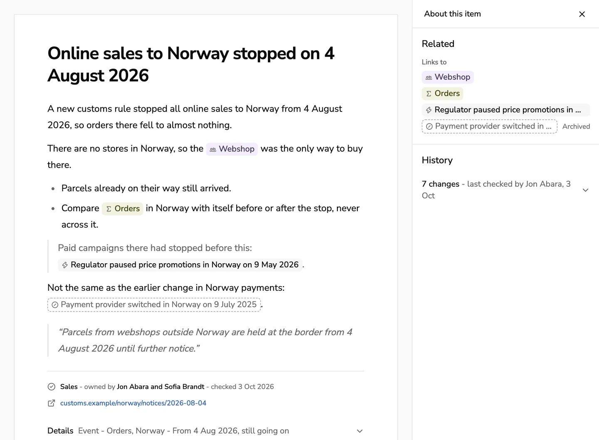

How to add a context item, what to put in it, and the line that stops an agent from reading a cause into it.

## Add a context item

To create one, open **Context** and choose **Write context**. The editor opens on a new item, with its first question: What should agents know?

When Ask finds nothing written about a question, an owner of its domain, or an admin, can choose Write context under the answer. The same editor opens, with what the question was about filled in.

## What a context item is

<!-- include word: Context item -->

One thing agents should know about the numbers: an event, a warning, a rule or a guide. It has a source and a check date.

<!-- /include -->

## The four kinds

<!-- include kinds -->

- **Event**: Something that happened on a date, like a stop or a new rule.
- **Warning**: A limit or problem agents should know, like late or missing data.
- **Rule**: A fixed way to read the numbers, like a house rule.
- **Guide**: What to check before you explain a change.

<!-- /include -->

A new context item starts as an Event. Pick another kind under Kind when it is one.

## What to put in it

1. A title that is one plain sentence, with its date.
2. What agents should know: two or three sentences, with what it is not if people mix it up.
3. Where and when it applies: the metrics and markets, and the dates.
4. A source anyone can open. The check date is set for you.
5. Don't conclude: the one line that stops an agent from reading a cause into it.

In a domain you own, it is published at once. In another domain it goes to that domain's owners as a suggestion: [Review a suggestion](review-a-suggestion.md) is what they do with it. Applies to names only what [Definitions](definitions-and-synonyms.md) lists.

## An example

The demo's item about the stop in Norway, owned by Sales, has every part. Here its dates leave out the year.

| Part                    | In the example                                                                                                                                                              |
| ----------------------- | --------------------------------------------------------------------------------------------------------------------------------------------------------------------------- |
| Kind                    | Event                                                                                                                                                                       |
| Title                   | Online sales to Norway stopped on 4 August                                                                                                                                  |
| What agents should know | A new customs rule stopped all online sales to Norway, so orders there fell to almost nothing. There are no stores in Norway, so the webshop was the only way to buy there. |
| Applies to              | Orders, Units sold and Gross sales, in Norway                                                                                                                               |
| When                    | From 4 August, still going on                                                                                                                                               |
| Source                  | A link to the customs notice, and the line copied from it, which says parcels from webshops outside Norway are held at the border                                           |
| Check date              | Set for you. Once it passes, the item is Due for a check.                                                                                                                   |
| Don't conclude          | Fewer orders in Norway after 4 August do not mean fewer customers.                                                                                                          |

The same news, written weakly:

| Part                    | In the weak item              | What is missing                                                       |
| ----------------------- | ----------------------------- | --------------------------------------------------------------------- |
| Title                   | Norway is down                | What is down, what happened, and when                                 |
| What agents should know | Sales in Norway dropped a lot | The cause, and how to compare the weeks before and after it           |
| Applies to              | Nothing                       | The metrics and the market, so agents know which questions it answers |
| Source                  | Nothing                       | A link anyone can open, so an owner can check it                      |
| Don't conclude          | Nothing                       | The line that stops an agent from blaming the drop on customers       |

## About our business

A short text every agent reads first: what the business is, words that are easy to misread, and house rules for reading numbers. No figures or customer names. An admin writes it in **Settings**, then **General**, under About our business.
